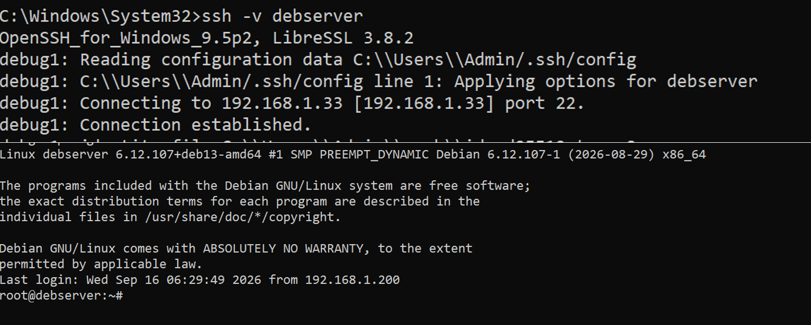
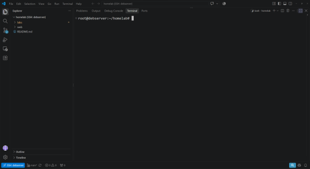
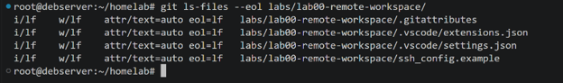

# Lab 00: Secure Remote Workspace & Workstation Toolchain

## Overview & The "Why"
Administering Linux servers via heavy graphical stacks (RDP, VNC, X11) introduces unnecessary memory consumption, display latency, and increases the attack surface. Additionally, editing infrastructure code across Windows and Linux environments frequently triggers silent syntax failures due to carriage return line endings (`CRLF` breaking bash interpreters and YAML parsers).

This module standardizes a professional headless engineering workflow:
* Windows 11 functions strictly as a local display client running Visual Studio Code.
* All computation, language servers, terminal shells, and Git operations execute natively on the remote Debian host via SSH.
* Cross-platform file integrity is enforced through repository-level `.gitattributes` (`LF` normalization).
* Manual uploads via web interfaces are eliminated by routing assets directly through the remote workspace filesystem.

---

## Architectural Layout

[Windows 11 Client]
├── Win32 OpenSSH (~/.ssh/id_ed25519, ~/.ssh/config)
├── Visual Studio Code (Local Renderer)
│     └── Remote - SSH Extension
└── Encrypted Tunnel (TCP Port 22, Ed25519)
│
▼
[Headless Debian Host: debserver (192.168.1.33)]
├── /usr/sbin/sshd (Hardened OpenSSH Daemon)
├── ~/.ssh/authorized_keys (Mode 0600)
├── ~/.vscode-server/ (Remote Extension Node & Tooling)
└── /root/homelab/ (Git Monorepo with EOL LF enforcement)

---

## Key Configurations

### 1. SSH Client Hardening (`ssh_config.example`)
* `IdentityFile ~/.ssh/id_ed25519`: Restricts authentication to modern elliptic-curve cryptography (Curve25519), avoiding legacy RSA key overhead.
* `IdentitiesOnly yes`: Forces the client to use only the defined key, preventing authentication drops caused by cycling through unrelated agent keys.
* `ServerAliveInterval 60` & `ServerAliveCountMax 3`: Sends encrypted heartbeat probes to prevent stateful NAT routers from dropping idle sessions.

### 2. Workspace Determinism & EOL Normalization
* `.gitattributes`: Declares `* text=auto eol=lf`, ensuring all text files and IaC definitions are normalized to Unix Line Feeds (`\n`) regardless of the client OS.
* `.vscode/settings.json`: Configures automated trailing whitespace removal, final newline injection, and integrated schema validation for Ansible and YAML.

---

## Verification & Artifacts

### 1. Verbose Cryptographic Handshake Trace
Authentication log confirming passwordless authorization via the client's `id_ed25519` keypair:

### 2. VS Code Remote-SSH Workspace Session
Operational workspace showing remote file tree navigation and direct terminal access inside `/root/homelab`:

### 3. Git EOL LF Normalization Audit
Verification output proving that repository files are indexed and checked out strictly with POSIX `LF` line terminators:

