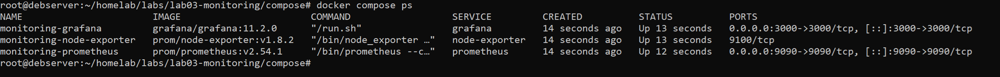
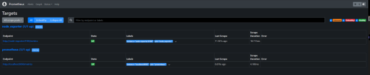
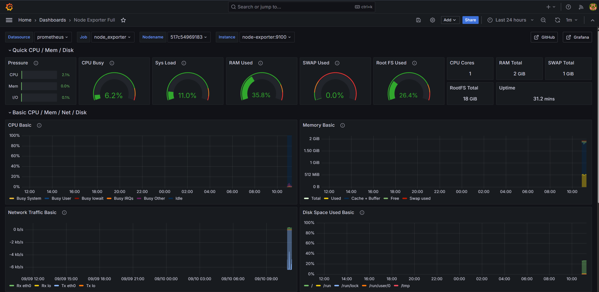

# Lab 03: Infrastructure Monitoring & Observability Stack (IaC)

## Overview
Deployment of a production-grade monitoring and observability stack using containerized services via Docker Compose. The architecture implements system metrics aggregation with Prometheus, real-time telemetry visualization via Grafana dashboards, and an Nginx reverse proxy routing external HTTP ingress traffic into the internal container network.

## Architecture Specifications

* **Host Node:** Debian 12 (Bookworm) `192.168.1.33`
* **Metrics Collector:** Prometheus Node Exporter `v1.8.2` (Host metrics via read-only `/proc`, `/sys`)
* **Time-Series Database:** Prometheus `v2.54.1` (Scrape interval: 15s)
* **Visualization Layer:** Grafana `11.2.0` (Node Exporter Full Dashboard ID: 1860)
* **Ingress / Reverse Proxy:** Nginx `1.27-alpine` (HTTP Reverse Proxy & WebSocket bridge)
* **Network Isolation:** Docker Bridge Network (`monitoring-net`)

## Break-Analyze-Fix / Root Cause Analysis (RCA)

### Incident 1: Ingress Port Collision on HTTP Bind (Port 80)
* **Symptom:** `docker compose up -d` failed on initializing `monitoring-nginx` with error `Bind for 0.0.0.0:80 failed: port is already allocated`.
* **Investigation & Triage:**
  * Executed socket inspection via `ss -tulpn | grep :80` revealing an active listener associated with `docker-proxy`.
  * Queried active container port bindings using `docker ps --filter "publish=80"` to locate the legacy running container occupying the socket.
* **Root Cause:** A legacy container from previous test configurations retained exclusive allocation of host port 80/tcp.
* **Resolution:** Terminated the offending container, released the socket, and executed `docker compose up -d --force-recreate` to bind port 80 strictly to `monitoring-nginx`.

## Key Configuration Files

* `compose/docker-compose.yml`: Declarative orchestration file defining service dependencies, volume persistence, and network policies.
* `configs/prometheus/prometheus.yml`: Scrape target configurations using Docker internal DNS resolution (`node-exporter:9100`).
* `configs/nginx/monitoring.conf`: Reverse proxy mapping with WebSocket upgrades for live dashboard telemetry.

## Verification & Telemetry Evidence

1. **Stack Execution:** Verified container lifecycles via `docker compose ps`.
   

2. **Scrape Target Health:** Validated Prometheus target state returning `UP (1/1)`.
   

3. **Metrics Visualization:** Rendered live node performance (CPU, Memory, Disk I/O, Network throughput) in Grafana.
   
