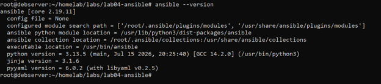
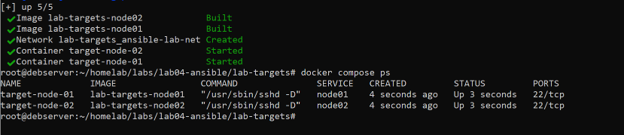
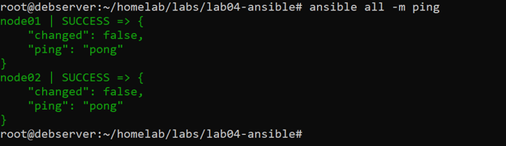
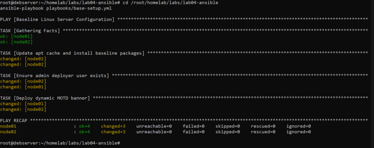
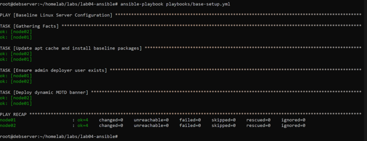
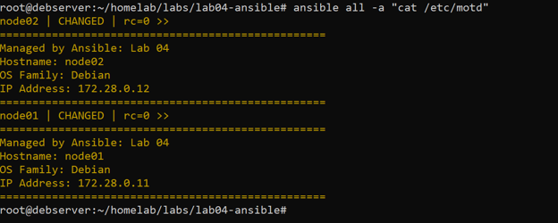

# Lab 04: Infrastructure Automation via Ansible

## Objective
Implement configuration management and Infrastructure as Code (IaC) principles to automate multi-node Linux provisioning using Ansible without centralized agent daemons.

---

## Architectural Layout
* **Control Node:** Host Debian server running Ansible Core 2.19.11, Python 3.13.5.
* **Authentication:** Passwordless SSH authentication using an ed25519 keypair.
* **Target Fleet:** Ephemeral containerized target nodes running OpenSSH and Python 3 inside an isolated Docker network (`ansible-lab-net: 172.28.0.0/16`):
  * `node01` (Web Group): `172.28.0.11`
  * `node02` (Database Group): `172.28.0.12`

[Control Node: debserver]
|
|-- SSH (Port 22, ed25519) --> [Target: node01 (172.28.0.11)]
|-- SSH (Port 22, ed25519) --> [Target: node02 (172.28.0.12)]

---

## Implementation Details

### 1. Inventory & Configuration
Configured `ansible.cfg` with disabled host key checking for automated headless execution. Grouped target endpoints into functional clusters via `inventories/hosts.ini`:
* Group `[webservers]`: `node01`
* Group `[dbservers]`: `node02`

### 2. Baseline Provisioning Playbook (`playbooks/base-setup.yml`)
* **Package Management:** Declarative installation of core operational utilities (`curl`, `htop`, `net-tools`, `vim`) ensuring `update_cache: yes`.
* **Identity Management:** Automated creation of administrative service user `deployer` with `/bin/bash` shell and home directory initialization.
* **Dynamic Fact Templating:** Deployment of `/etc/motd` populated with Jinja2 dynamic system variables (`ansible_hostname`, `ansible_os_family`, `ansible_default_ipv4.address`).

### 3. Idempotency Verification
Executed repeated playbook runs against running instances. The second execution resulted in `changed=0` across all managed targets, confirming that declarative desired state matches live system state without side effects.

---

## Verification & Artifacts

### 1. Ansible Installation

### 2. Managed Target Topology Up

### 3. Connectivity Verification (Ad-Hoc Ping)

### 4. Initial Playbook Run

### 5. Idempotency Confirmation

### 6. Dynamic MOTD Inspection

